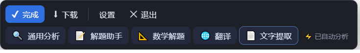
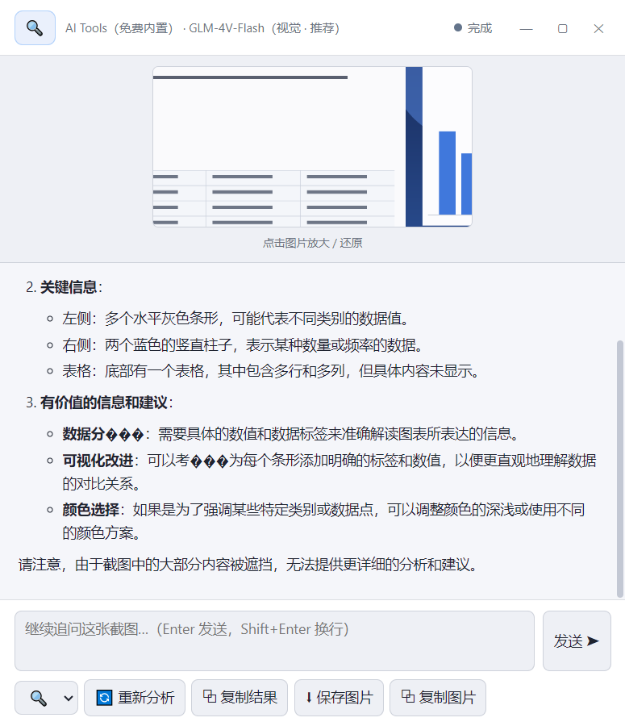
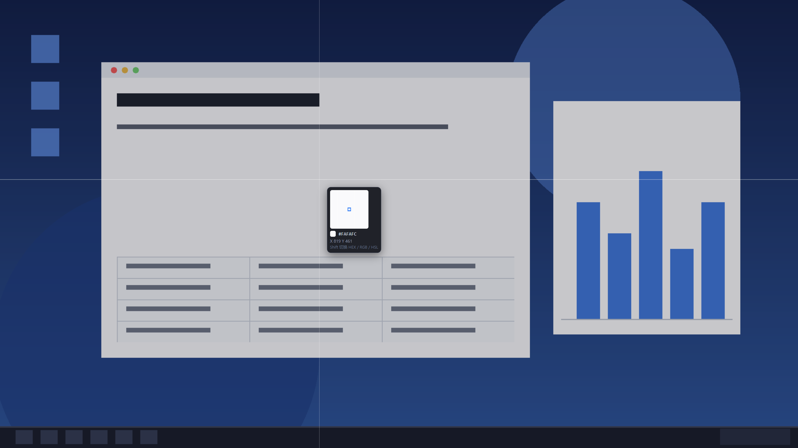
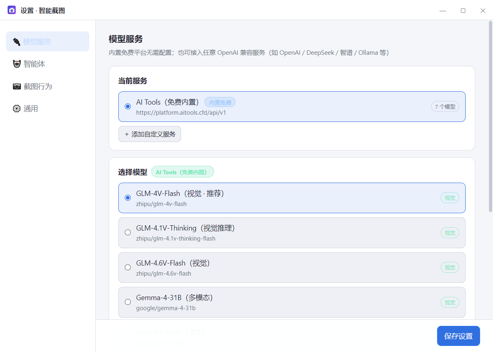

# Smart Capture

[中文](README.md)

Cross-platform (Windows / macOS) AI screenshot analysis desktop app: capture → annotate → one click to analyze the image with an LLM (homework, math, translation, OCR, etc.), or pin the screenshot on screen.

## ✨ Features

### Capture & selection
- **🎯 Area capture**: global shortcut (default `Ctrl/Cmd+Alt+X`, configurable) or tray trigger, drag to select
- **Selection re-adjust**: after confirming, resize with 8 handles or move with edge bands — no need to capture again
- **Color picker**: Shift to cycle HEX / RGB / HSL, magnifier + crosshair
- **Multi-monitor & HiDPI**: crops by physical pixels, stays sharp on scaled displays

### Annotation (Fabric.js)
- **Rectangle / ellipse / line / arrow / pencil / highlighter / mosaic / text**
- Each tool remembers its own color and stroke width; **mosaic follows the drag live**, text uses a dedicated **font-size dropdown (10–96)**
- Undo / redo / clear; annotations are final once drawn (no accidental dragging)

### Toolbar
- One row: `drag handle | annotation tools | color / width | undo·redo·clear | ✕ Save 📌 ✔`, agents on a second row
- The left handle drags the toolbar anywhere; position is anchored so expanding the style row never shifts it
- Tools toggle on/off: the style row hides when no tool is selected; follows system / dark / light theme

### Pin to screen
- **📌 Pin**: turn the annotated screenshot into an always-on-top window; draggable, multiple pins allowed
- Border tinted blue and brightens on hover so it stands out from the real screen; close via ✕ / double-click / right-click / ESC

### Screen recording
- **Area recording**: global shortcut (default `Ctrl/Cmd+Alt+R`, configurable) or tray trigger; pick `MP4` / `GIF` inside the selection, then a **3-second countdown** before recording starts (silent)
- **Duration limit**: `MP4` up to **60 minutes**, `GIF` up to **60 seconds**; stops automatically at the limit and goes straight to the preview
- **Selection stays visible**: a blue frame matching the selection border is drawn around the selection while recording (click-through, so it never blocks the app underneath; drawn outside the crop so it is never captured)
- **Recording bar**: sits just outside the selection, draggable, shows a live timer; `Stop` / `Cancel`. Clicking `Stop` hides both the bar and the frame
- **Preview before deciding**: a preview window opens after stopping (draggable, minimize / maximize / close) with `Copy to clipboard` and `Save`; it closes itself after either succeeds, while `✕` simply discards
- **Copy to clipboard** puts the video/GIF on the clipboard as a **file** (paste straight into chat apps or Explorer); saving reveals the file in its folder
- Records the raw screen stream and crops to the selection on save (physical pixels on HiDPI), so it no longer depends on compositor frames — static screens still record. Recording is written to a temp file in chunks, so memory stays flat

### AI analysis
- **📦 5 built-in agents**: 🔍 General Analysis, 📝 Homework Solver, 📐 Math Solver (LaTeX), 🌐 Translate, 📄 Text Extraction
- **✏️ Custom agents**: icon *or* name (only one required) + system prompt + optional model override
- **🆓 Free built-in models**: AI Tools platform (platform.aitools.cfd), free key included, default `zhipu/glm-4v-flash`; rate-limited to 1 req/3s with automatic retry
- **🔌 Custom model services**: any OpenAI-compatible API (Base URL + key + model list), with vision flag, **thinking-mode toggle (off by default)** and connectivity test
- **⚡ Default agent + auto-analyze**: analysis starts right after the selection when enabled

### Misc
- **Result window**: streaming Markdown, collapsible thinking, KaTeX formulas, follow-up chat, copy/save image, switch agent to re-analyze
- **🌐 Bilingual (Chinese/English)**, tray resident, launch at login, customizable shortcut, frameless custom title bar

## 📸 Screenshots






## 🚀 Installation

### Windows
1. Download `SmartCapture-Setup-1.0.0.exe` from [Releases](https://github.com/ahnuchen/smart-capture/releases)
2. Double-click to install, desktop shortcut created
3. After first launch the app stays in the tray; press `Ctrl+Shift+A` to capture

### macOS
```bash
npm run dist-mac  # Must run on Mac
```
First run requires permission in System Settings → Privacy & Security → Screen Recording.

## 🛠️ Development

```bash
git clone https://github.com/ahnuchen/smart-capture.git
cd smart-capture
npm install          # For China network: ELECTRON_MIRROR=https://npmmirror.com/mirrors/electron/ npm install
npm start            # Run (stays in tray, press Ctrl+Shift+A to capture)
npm run dev          # Debug mode (renderer logs forwarded to the terminal)
npm run dev:tools    # Debug + auto-open DevTools for overlay/toolbar (detached DevTools changes z-order)
```

Stack: Electron 33 + **Vue 2.7 (UMD `<script>` + `<script type="text/x-template">`, no bundler)**, Fabric.js 5 for annotation, marked + DOMPurify + KaTeX for rendering. Every renderer window is `index.html` (`#tpl-*` templates) + `*-app.js` (component) + a boot script; state is never stored on `window.api` (the contextBridge object is frozen).

### Self-test
```bash
node scripts/gen-testscreen.js   # Generate a fake screen for self-test
npx electron . --selftest --fake-screen   # End-to-end self-test (artifacts in test-artifacts/)
```

## 📦 Build

```bash
npm run dist-win     # Windows NSIS installer → dist/
npm run dist-mac     # macOS dmg (must run on Mac)
```

For China network, add mirror env vars:
```bash
ELECTRON_MIRROR=https://npmmirror.com/mirrors/electron/ \
ELECTRON_BUILDER_BINARIES_MIRROR=https://npmmirror.com/mirrors/electron-builder-binaries/ \
npm run dist-win
```

## ⚠️ Notes

- macOS first use requires Screen Recording permission in System Settings → Privacy & Security → Screen Recording
- The built-in free key ships with the installer (visible to anyone); if rate-limited, change it in Settings → Model Services or connect your own service
- Thinking mode is per model and sends `thinking.type` in the request body; adapt the code if your provider expects a different field (e.g. `reasoning_effort`)
- If capture fails with a security warning, it is usually enterprise DLP / screen protection blocking system screen capture; whitelist the app

## 📁 Project Structure

```
src/
├── main/          # Main process: capture orchestration / analysis session / AI client / settings store / tray
├── preload/       # contextIsolation security bridge
├── renderer/
│   ├── shared/    # vue-i18n.js: $t for Vue windows (dictionary fetched once at boot)
│   ├── overlay/   # Fullscreen overlay: selection, re-adjust, Fabric annotation, color picker
│   ├── toolbar/   # Floating toolbar: tools / styles / output actions / agents
│   ├── pin/       # Pin window (Vue): image + drag + close
│   ├── recorder/  # Hidden recorder page: desktop stream → MediaRecorder (WebM), chunked to main
│   ├── recbar/    # Recording bar (Vue): timer / stop / cancel / drag
│   ├── recframe/  # Recording area border (click-through transparent window)
│   ├── preview/   # Recording preview (Vue): playback + copy to clipboard / save
│   ├── result/    # Result window (streaming Markdown + KaTeX + follow-up)
│   └── settings/  # Settings (model services / agent CRUD / behavior / language / theme)
└── shared/        # Built-in agents & free model definitions, i18n dictionary
```

## 📄 License

MIT

## 🙏 Acknowledgments

- Free models provided by [AI Tools Platform](https://platform.aitools.cfd/)
- Built with [Electron](https://www.electronjs.org/), [Vue 2](https://v2.vuejs.org/) and [Fabric.js](http://fabricjs.com/)
